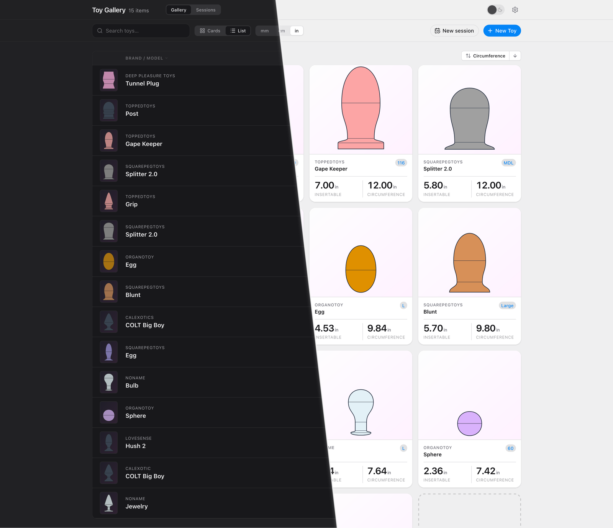
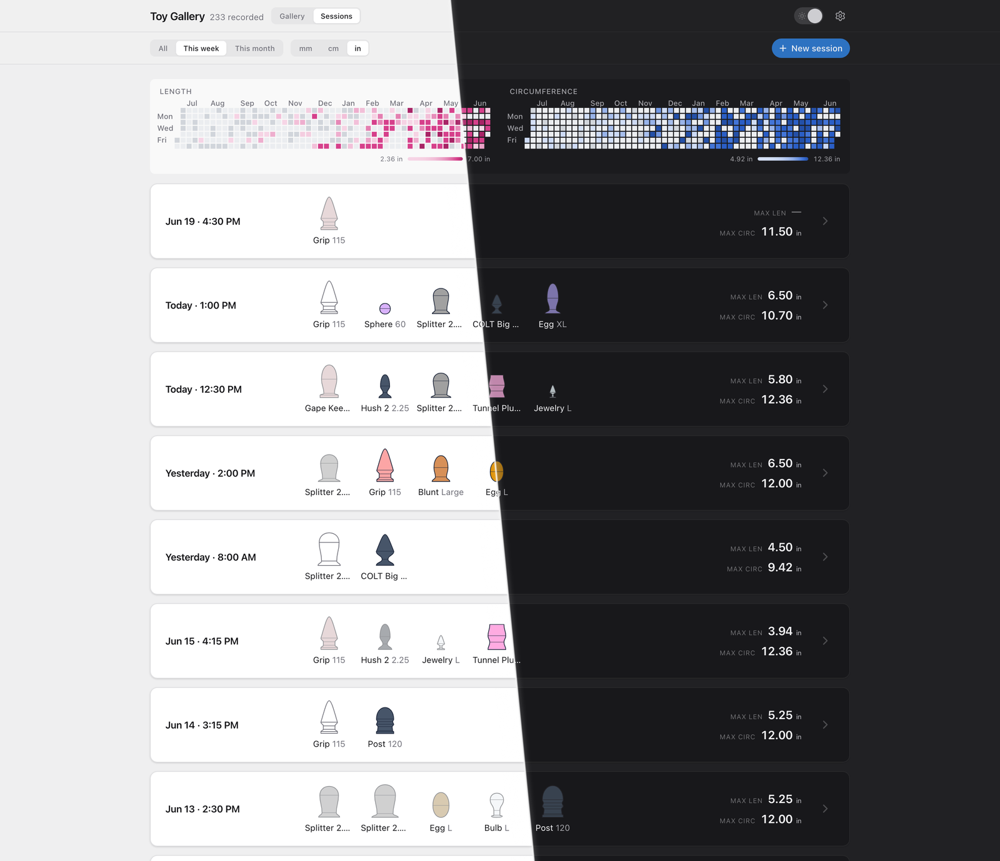

# Toy Gallery

Your whole collection in one place — see everything at a glance, keep the details that matter, and track your sessions and progress over time.

It runs on your own machine, so your collection stays yours. Nothing is shared, nothing is tracked, nothing leaves your device.

## Highlights

- **Your collection at a glance.** Every toy gets its own picture that matches its real shape and size, so you recognize each one instantly — drawn in a built-in editor, no photos needed.
- **Keep the details that matter.** Brand, model, size, color, and any notes or fields you want to add.
- **Track your sessions.** Jot down what you reached for and when, then watch your activity and progress build up over time.
- **Works on any screen.** Looks right whether you're on your laptop or your phone.
- **Light and dark.** Pick whichever's easier on the eyes.
- **Always yours to take.** Export your entire collection any time, and bring it back just as easily.

## A look inside

Browse your whole collection as roomy cards or a compact list, and look back over your sessions — all in light or dark, whichever suits the moment.

<table>
  <tr>
    <td width="50%"></td>
    <td width="50%"></td>
  </tr>
</table>

## Run it on your own machine

You need [Docker](https://docs.docker.com/get-docker/) installed. The app ships as a single image — `ghcr.io/off-by-one-pixel/toy-gallery:latest` — that bundles the backend, the frontend, and an embedded database. No separate database service to run, no extra setup.

Pick one of the two ways below.

### With `docker run`

```bash
docker run -d \
  --name toy-gallery \
  -p 8000:8000 \
  -v ./data:/data \
  -e INITIAL_USERNAME=admin \
  -e INITIAL_PASSWORD=change-me \
  ghcr.io/off-by-one-pixel/toy-gallery:latest
```

Open <http://localhost:8000>, sign in with the username and password you set above, and change the password.

### With Docker Compose

Save this as `docker-compose.yml` next to a folder named `data/`:

```yaml
services:
  toy-gallery:
    image: ghcr.io/off-by-one-pixel/toy-gallery:latest
    ports:
      - "8000:8000"
    volumes:
      - ./data:/data
    environment:
      INITIAL_USERNAME: admin
      INITIAL_PASSWORD: change-me
      # TRUSTED_ORIGINS: https://your.domain     # once you front this with HTTPS
    restart: unless-stopped
```

Then `docker compose up -d` in that folder.

### Where your data lives

Everything the app needs to keep — the database, an auto-generated secret key, migration archives — lives in the `data/` folder you mounted as `/data`. Back up that folder and you have backed up your whole instance. Move that folder to a different machine and the app picks up where it left off.

## Configuration

All optional. Set only what you need.

| Variable           | Default            | What it does                                                                                                                |
|--------------------|--------------------|-----------------------------------------------------------------------------------------------------------------------------|
| `INITIAL_USERNAME` | unset              | Together with `INITIAL_PASSWORD`, creates the admin account on first run.                                                   |
| `INITIAL_PASSWORD` | unset              | Initial password for the admin account. Change it after first login.                                                        |
| `INITIAL_EMAIL`    | empty              | Optional email for the admin.                                                                                               |
| `TRUSTED_ORIGINS`  | empty              | Comma-separated list of public URLs the app is reached from once it's behind HTTPS.                                         |
| `DATA_DIR`         | `/data`            | Where SQLite, the secret key, and migration archives live inside the container. Change only if you mount somewhere else.    |
| `SECRET_KEY`       | auto-generated     | Set this to manage the Django secret key yourself.                                                                          |
| `PORT`             | `8000`             | Port the app listens on inside the container.                                                                               |
| `WORKERS`          | `3`                | Number of web workers. Bump it on bigger machines.                                                                          |
| `SSL_CERT_PATH`    | `$DATA_DIR/certs/cert.pem` | TLS certificate path inside the container. If this and `SSL_KEY_PATH` both exist, the app serves HTTPS directly.    |
| `SSL_KEY_PATH`     | `$DATA_DIR/certs/key.pem`  | Private key matching the certificate above.                                                                         |
